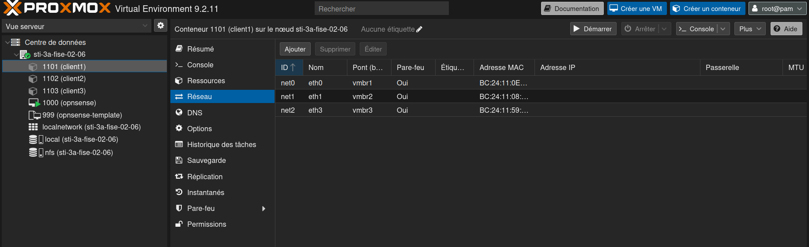
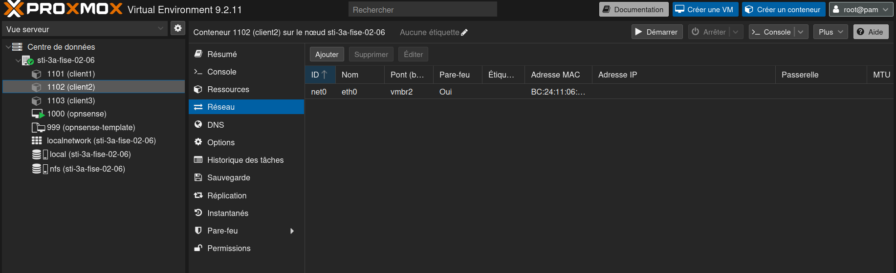
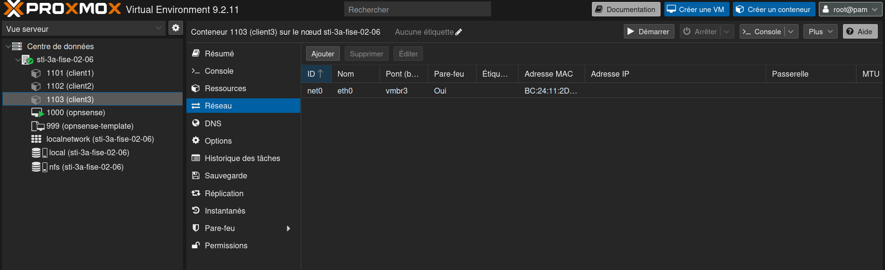

# Rapport — TP noté Proxmox

**Auteur :** Ulrich Brayanne Tienou — 3A STI, INSA CVL

---

## Exercice 1 — Adresses statiques et routage IP

### Q1.1 Création des conteneurs

```sh
pct clone ...   # ou création depuis le template debian13 du stockage nfs
```

### Q1.2 Noms d'hôtes

```sh
hostnamectl set-hostname tienoubobcat1   # idem 2 et 3
```

### Q1.3 Configuration des interfaces

Fichiers : [`configs/client1`](configs/client1/etc/network/interfaces),
[`configs/client2`](configs/client2/etc/network/interfaces),
[`configs/client3`](configs/client3/etc/network/interfaces).





### Q1.4 Tables de routage

`ip route` sur client1 :

```
(à coller)
```

Explication des 4 lignes :

1. `default via ...` —
2. `10.0.0.0/24 dev eth0` —
3. `10.10.2.0/24 dev eth1` —
4. `10.10.3.0/24 dev eth2` —

Comparaison avec client2 :

Pourquoi client1 n'a pas eu besoin qu'on lui configure une passerelle à la main :

---

## Exercice 2 — Forwarding et masquerade

### Q2.1 IP forwarding

Résultats des pings :

À quoi sert l'IP forwarding :

```sh
sysctl -w net.ipv4.ip_forward=1
```

### Q2.2 Masquerade

À quoi sert la masquerade :

Pourquoi le ping de client2 vers 8.8.8.8 passe ensuite :

### Q2.3 Persistance

Fichiers : [`99-ip-forward.conf`](configs/client1/etc/sysctl.d/99-ip-forward.conf),
[`nftables.conf`](configs/client1/etc/nftables.conf) + `systemctl enable nftables`.

---

## Exercice 3 — Serveur DHCP

### Q3.1 isc-dhcp-server sur vmbr3

Fichiers : [`dhcpd.conf`](configs/client1/etc/dhcp/dhcpd.conf),
[`isc-dhcp-server`](configs/client1/etc/default/isc-dhcp-server).

Choix de la passerelle et du DNS :

### Q3.2 Test avec cloneTest

---

## Exercice 4 — Serveur DNS

### Q4.1 bind9 sur client2

Fichiers : [`named.conf.options`](configs/client2/etc/bind/named.conf.options),
[`named.conf.local`](configs/client2/etc/bind/named.conf.local),
[`db.tienou-tp.insa-cvl.fr`](configs/client2/etc/bind/db.tienou-tp.insa-cvl.fr).

### Q4.2 DNS distribué par le DHCP

---

## Exercice 5 — NAT one-to-one

### Q5.1 apache2 sur client3

### Q5.2 curl depuis cloneTest (vmbr3)

### Q5.3 Redirection des ports 53 et 80 sur client1

---

## Exercice 6 — SSH

### Q6.1 sshd

Comment appelle-t-on un processus qui reste à l'écoute :

### Q6.2 PermitRootLogin

### Q6.3 Tunnel cloneTest → client1

### Q6.4 Fichier `abc`

### Q6.5 Tunnel client1 → client3, fichier `def`

### Q6.6 Pourquoi cloneTest → client3 échoue

### Q6.7 Adresse secondaire et redirection du port 22
